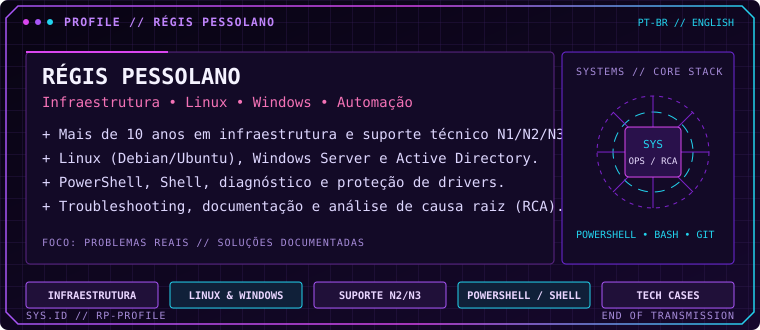
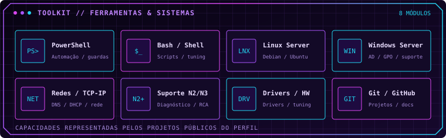
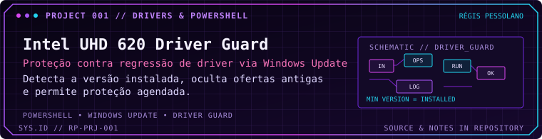
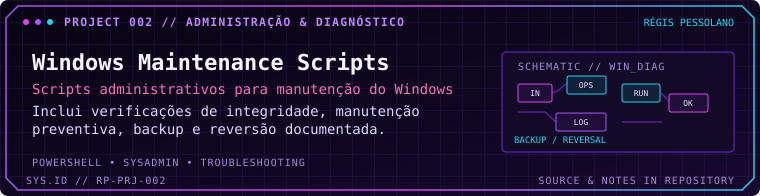
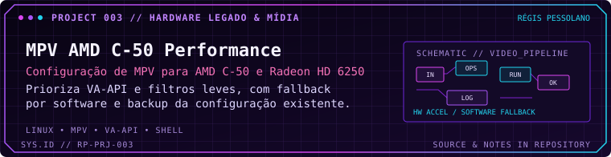
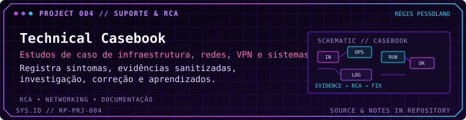
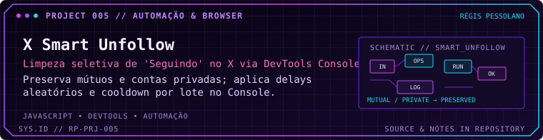
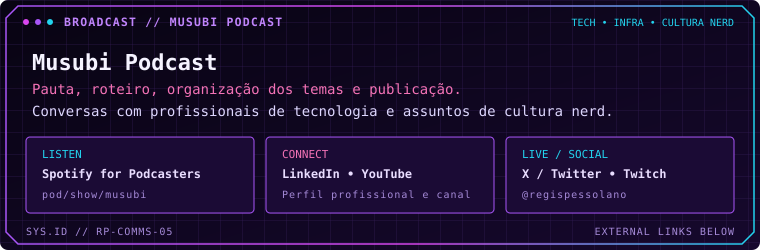

<!-- Perfil GitHub Cyberpunk Neon HUD — Régis Pessolano (@RegisPessolano) -->
<!-- Layout inspirado no perfil de @mille-okws: https://github.com/mille-okws -->

Layout e tema visual inspirados no perfil <a href="https://github.com/mille-okws"><b>@mille-okws</b></a> (<a href="https://github.com/mille-okws/mille-okws">README original</a>).
Adaptação e conteúdo próprios, desenvolvidos com apoio de IA (Gemini/Codex).

## // SOBRE

Infraestrutura de TI, Linux/Windows e automação. Há mais de 10 anos atuo com infraestrutura e suporte técnico (N1–N3): Windows Server e Active Directory, estações Linux (Debian/Ubuntu), redes e diagnóstico de causa raiz.

Meu jeito de trabalhar é transformar problema recorrente em **script, checklist ou documentação** — sempre com backup e caminho de volta. Os repositórios abaixo são ferramentas do dia a dia, não código de vitrine.

> **Foco atual:** automação de manutenção no Windows, proteção contra regressão de drivers e registro de casos técnicos.

## // PROJETOS

| Projeto | O que resolve | Stack |
| :-- | :-- | :-- |
| **[Intel UHD 620 Driver Guard](https://github.com/RegisPessolano/intel-uhd620-driver-guard)** | Impede o Windows Update de trocar um driver Intel mais novo por pacotes OEM antigos, com proteção agendada. | PowerShell |
| **[Windows Maintenance Scripts](https://github.com/RegisPessolano/windows-maintenance-scripts)** | Scripts administrativos (cache, Windows Hello, VBS/HVCI, energia) com impacto e reversão documentados. | PowerShell · Batch |
| **[MPV AMD C-50 Performance](https://github.com/RegisPessolano/mpv-amd-c50-performance)** | MPV em hardware legado: VA-API, filtros leves, fallback por software e backup da configuração. | Linux · Shell |
| **[Technical Casebook](https://github.com/RegisPessolano/technical-casebook)** | Casos de infraestrutura, redes e VPN com evidências sanitizadas, hipóteses separadas dos fatos e RCA. | Redes · RCA · Docs |
| **[X Smart Unfollow](https://github.com/RegisPessolano/x-smart-unfollow)** | Limpeza seletiva de "Seguindo" no X via Console: preserva mútuos e contas privadas, com delays e cooldown por lote. | JavaScript · DevTools |

## // STACK

`PowerShell` · `Bash / Shell` · `Linux (Debian/Ubuntu)` · `Windows Server` · `Active Directory` · `Redes / TCP-IP` · `DNS / DHCP` · `Git` · `JavaScript` · `Suporte N2/N3`

## // CONTATO

[LinkedIn](https://www.linkedin.com/in/regispessolano/) · [YouTube](https://www.youtube.com/@regispessolano) · [X / Twitter](https://x.com/regispessolano) · [Twitch](https://www.twitch.tv/regispessolano) · [Musubi Podcast](https://podcasters.spotify.com/pod/show/musubi)

<b>English version</b>

 

**IT infrastructure, Linux/Windows and automation.** 10+ years in infrastructure and technical support (L1–L3): Windows Server and Active Directory, Linux workstations (Debian/Ubuntu), networking and root cause analysis.

I turn recurring problems into **scripts, checklists or documentation** — always with a backup and a rollback path.

**Currently:** Windows maintenance automation, driver regression protection and technical case documentation.

**Projects**

- [**Intel UHD 620 Driver Guard**](https://github.com/RegisPessolano/intel-uhd620-driver-guard) — keeps Windows Update from replacing a newer Intel driver with older OEM packages.
- [**Windows Maintenance Scripts**](https://github.com/RegisPessolano/windows-maintenance-scripts) — documented admin scripts with explicit impact and rollback notes.
- [**MPV AMD C-50 Performance**](https://github.com/RegisPessolano/mpv-amd-c50-performance) — MPV on legacy hardware: VA-API, light filters and software fallback.
- [**Technical Casebook**](https://github.com/RegisPessolano/technical-casebook) — infrastructure, networking and VPN case studies with sanitized evidence and RCA.
- [**X Smart Unfollow**](https://github.com/RegisPessolano/x-smart-unfollow) — selective unfollow via browser Console, preserving mutual followers and private accounts, with random delays and batch cooldowns.

**Stack:** `PowerShell` · `Bash / Shell` · `Linux (Debian/Ubuntu)` · `Windows Server` · `Active Directory` · `Networking / TCP-IP` · `DNS / DHCP` · `Git` · `JavaScript` · `L2/L3 support`

