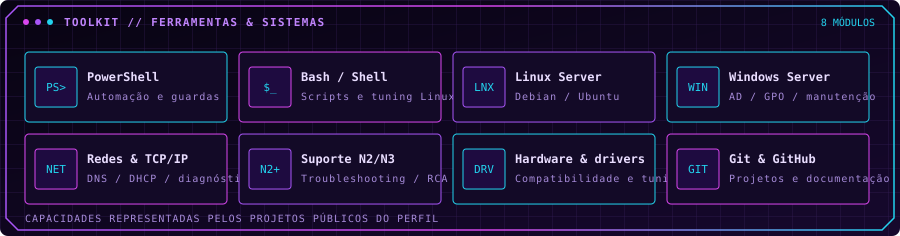
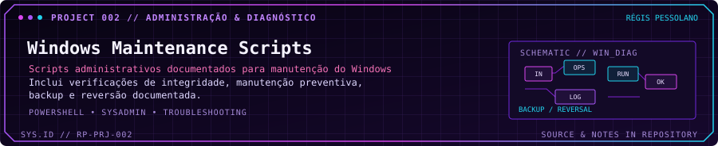
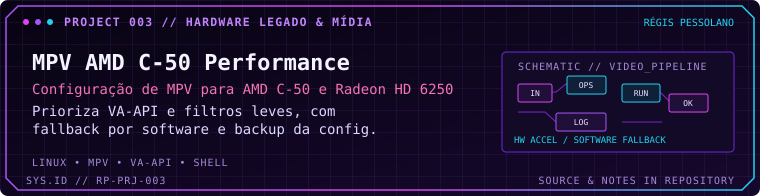
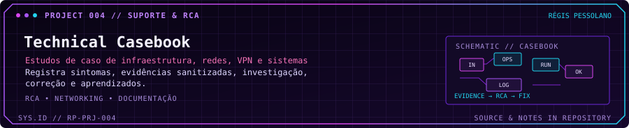
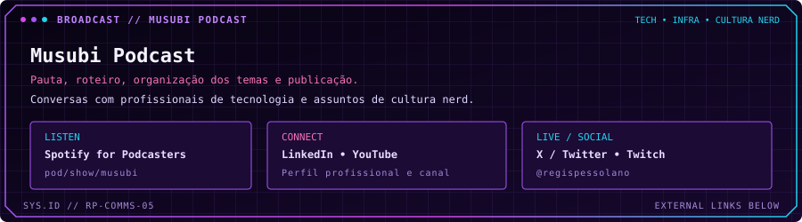

<!-- Perfil GitHub Cyberpunk Neon HUD — Régis Pessolano (@RegisPessolano) -->
<!-- Layout inspirado no perfil de @mille-okws: https://github.com/mille-okws -->

Layout e tema visual inspirados no perfil <a href="https://github.com/mille-okws"><b>@mille-okws</b></a> (<a href="https://github.com/mille-okws/mille-okws">README original</a>).
Adaptação e conteúdo próprios, desenvolvidos com apoio de IA (Gemini/Codex).

